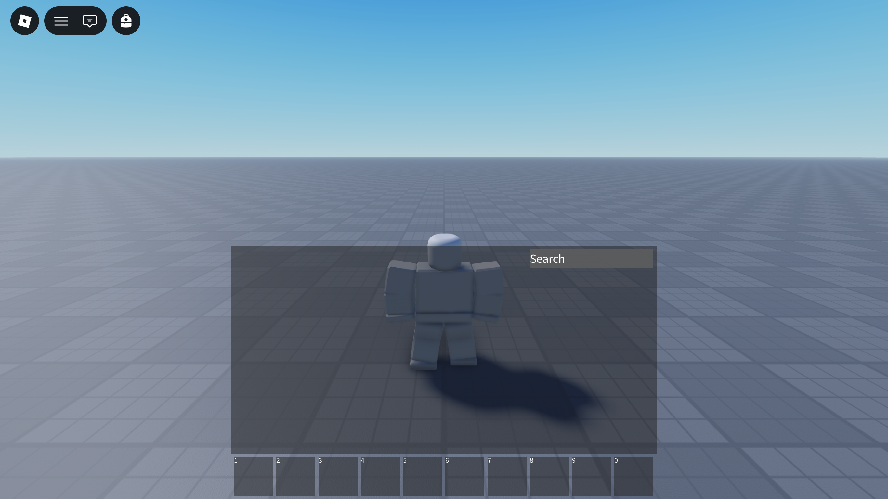

# Purse

Purse is a fork of the [default Roblox backpack] decoupled from the CoreGui, allowing developers to access APIs that were previously unavailable and to modify the code.

* Source code modification
* Developer APIs for controlling the inventory
* Not reliant on CoreGui permissions

Purse is not a major improvement over the CoreGui backpack; it is a copy of it, so developers can iterate on it themselves. There are no additional features beyond what the CoreGui backpack provides.

  [default Roblox backpack]: https://github.com/MaximumADHD/Roblox-Client-Tracker/blob/roblox/scripts/CoreScripts/Modules/BackpackScript.lua

## Demo

You can play the [Purse Demo] on Roblox to try out Purse before using it. The place is uncopylocked so you can access an editable copy of the experience.

[Play on Roblox][Purse Demo]{ .md-button .md-button--primary }

  [Purse Demo]: https://www.roblox.com/join/sc1eh

## Notes

Because we can't access the topbar without CoreGui, we use [TopbarPlus]. This is one of the major differences in terms of functionality. TopbarPlus may be less familiar when used with a controller.

  [TopbarPlus]: https://devforum.roblox.com/t/topbarplus/1017485
